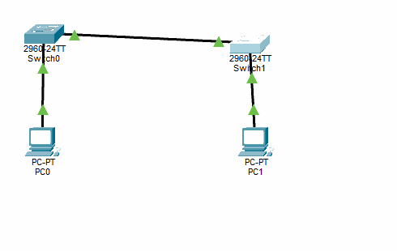

# Task 1 — Basic Switch and End Device Configuration


> A practical Layer 2 networking lab that builds a small LAN, configures two Cisco switches and two end devices, assigns management and host IPv4 addresses, secures console and privileged access, and validates connectivity.

## Project information

| Item | Details |
|---|---|
| Course | Computer Networks (0790422) |
| Institution | Philadelphia University |
| Academic term | First Semester 2026/2027 |
| Lab / chapter | Chapter 4 — Basic Switch Configuration |
| Simulator | Cisco Packet Tracer |
| Switch model | Cisco Catalyst 2960-24TT |
| IOS shown in device output | 15.0(2)SE4 |
| Packet Tracer project | `Task1_Basic_Switch_Configuration.pkt` (supplied separately; repository upload is pending) |

---

## Table of contents

1. [Project overview](#1-project-overview)
2. [Learning objectives](#2-learning-objectives)
3. [Network topology](#3-network-topology)
4. [Physical links and port mapping](#4-physical-links-and-port-mapping)
5. [IPv4 addressing plan](#5-ipv4-addressing-plan)
6. [End-device configuration](#6-end-device-configuration)
7. [Switch configuration](#7-switch-configuration)
8. [Command reference and explanations](#8-command-reference-and-explanations)
9. [Verification and testing](#9-verification-and-testing)
10. [Interface status worksheet](#10-interface-status-worksheet)
11. [Reflection questions](#11-reflection-questions)
12. [Troubleshooting guide](#12-troubleshooting-guide)
13. [Evidence and screenshots](#13-evidence-and-screenshots)
14. [How to open the Packet Tracer project](#14-how-to-open-the-packet-tracer-project)
15. [Repository contents](#15-repository-contents)
16. [Security and lab limitations](#16-security-and-lab-limitations)

---

## 1. Project overview

The goal of this exercise is to create and configure a simple switched Ethernet LAN in Cisco Packet Tracer. The network contains two Catalyst 2960 switches and two PCs. Each PC connects to a local switch, and the two switches are connected to each other so that both hosts can communicate across the same LAN.

The exercise combines several foundational networking tasks:

- Build a logical topology using the required network devices.
- Connect devices through the specified FastEthernet interfaces.
- Assign static IPv4 addresses to both PCs.
- Configure a management Switch Virtual Interface (SVI) on each switch.
- Apply basic device identification and access-protection settings.
- Save the active configuration so it is retained after a simulated restart.
- Inspect device configuration, IOS information, and interface states.
- Test reachability with ICMP echo requests using `ping`.

The completed simulation is provided in the Packet Tracer project file linked above. The rest of this document explains the addressing plan, configuration sequence, commands, verification process, and observations so the lab can be reviewed or reproduced.

## 2. Learning objectives

After completing the lab, a student should be able to:

1. Distinguish between User EXEC, Privileged EXEC, Global Configuration, and Interface Configuration modes.
2. Identify a switch management SVI and configure its IPv4 address.
3. Assign static IPv4 settings to end devices.
4. Configure a hostname, disable unwanted DNS lookup behavior, and set basic console and privileged access credentials.
5. Understand the difference between the active `running-config` and the saved `startup-config`.
6. Use Cisco IOS `show` commands to inspect a switch.
7. Interpret interface state information such as `up/up` and `down/down`.
8. Use `ping` to test connectivity and identify common causes of failed communication.

## 3. Network topology

The topology is built from four devices:

- **S1** — first Cisco Catalyst 2960 switch.
- **S2** — second Cisco Catalyst 2960 switch.
- **PC-A** — end device connected to S1.
- **PC-B** — end device connected to S2.



### Logical layout

```text
 PC-A                         PC-B
  |                            |
 Fa0                          Fa0
  |                            |
Fa0/6                        Fa0/18
  |                            |
 +----- S1 ---- Fa0/1 ---- Fa0/1 ---- S2 -----+
```

The two switches provide the Layer 2 path between the end devices. Both PC network interfaces and both switch management interfaces are addressed in the same IPv4 subnet.

### Device labels in the Packet Tracer workspace

The simulator initially assigns generic names to newly placed devices. The intended logical names for this lab are:

| Packet Tracer default label | Lab name |
|---|---|
| Switch0 | S1 |
| Switch1 | S2 |
| PC0 | PC-A |
| PC1 | PC-B |

The configured switch hostnames are `S1` and `S2`. The PC labels are used to make the topology and documentation easier to read.

## 4. Physical links and port mapping

The lab uses the following port assignments.

| Endpoint A | Interface | Endpoint B | Interface |
|---|---|---|---|
| PC-A | FastEthernet0 | S1 | FastEthernet0/6 |
| S1 | FastEthernet0/1 | S2 | FastEthernet0/1 |
| S2 | FastEthernet0/18 | PC-B | FastEthernet0 |

### Cable selection

| Link | Cable type | Reason |
|---|---|---|
| PC-to-switch | Copper Straight-Through | Connects an end device to a switch access port |
| Switch-to-switch | Copper Cross-Over | Connects two switch Ethernet interfaces in the topology |

Packet Tracer versions and device models may support automatic crossover through Auto-MDIX. For this assignment, follow the cable type requested by the lab instructions and verify that the link indicators become green.

**Important distinction:** the Console port is for out-of-band device management. It is not used for the Ethernet data links shown in the topology. In Packet Tracer, the switch CLI can be opened directly from the device window for this exercise.

## 5. IPv4 addressing plan

All four addressed interfaces belong to the `192.168.1.0/24` network.

| Device | Interface | IPv4 address | Subnet mask | Purpose |
|---|---|---:|---:|---|
| S1 | VLAN 1 | `192.168.1.1` | `255.255.255.0` | Switch management |
| S2 | VLAN 1 | `192.168.1.2` | `255.255.255.0` | Switch management |
| PC-A | NIC / FastEthernet0 | `192.168.1.10` | `255.255.255.0` | Host address |
| PC-B | NIC / FastEthernet0 | `192.168.1.11` | `255.255.255.0` | Host address |

### Addressing notes

- The subnet mask `255.255.255.0` is equivalent to the prefix length `/24`.
- Each device has a unique host address.
- The switch IP addresses are configured on the VLAN 1 SVI, not on the physical access ports.
- The addressing table supplied for this lab does not specify a default gateway. A gateway is not required for communication among these devices while they remain in the same subnet.

## 6. End-device configuration

Configure both PCs through the Packet Tracer desktop interface.

1. Open **PC-A**.
2. Select **Desktop → IP Configuration**.
3. Choose **Static**.
4. Enter:
   - IP address: `192.168.1.10`
   - Subnet mask: `255.255.255.0`
5. Repeat for **PC-B** with:
   - IP address: `192.168.1.11`
   - Subnet mask: `255.255.255.0`

Leave the default gateway blank unless the instructor's worksheet specifies a gateway for an extended version of the task.

After configuring the hosts, open **Desktop → Command Prompt** to run connectivity tests.

## 7. Switch configuration

The following command sequences document the baseline configuration used for the two switches. Execute the S1 sequence on S1 and the S2 sequence on S2. Commands are shown in the order in which they should be entered.

### 7.1 S1 configuration

```text
enable
configure terminal
hostname S1
no ip domain-lookup
enable secret class
line console 0
 password cisco
 login
exit
interface vlan 1
 ip address 192.168.1.1 255.255.255.0
 no shutdown
exit
banner motd #WARNING: Unauthorized access is prohibited!#
end
copy running-config startup-config
```

### 7.2 S2 configuration

```text
enable
configure terminal
hostname S2
no ip domain-lookup
enable secret class
line console 0
 password cisco
 login
exit
interface vlan 1
 ip address 192.168.1.2 255.255.255.0
 no shutdown
exit
banner motd #WARNING: Unauthorized access is prohibited!#
end
copy running-config startup-config
```

### Configuration differences

The two switches receive the same baseline settings. The two deliberate differences are:

| Setting | S1 | S2 |
|---|---|---|
| Hostname | `S1` | `S2` |
| VLAN 1 IP address | `192.168.1.1/24` | `192.168.1.2/24` |

The unique hostname and management address make each switch distinguishable during administration and testing.

## 8. Command reference and explanations

This section explains what each important command does and the mode in which it is entered.

| Command | Mode / context | Purpose |
|---|---|---|
| `enable` | User EXEC | Enters Privileged EXEC mode |
| `configure terminal` | Privileged EXEC | Enters Global Configuration mode |
| `hostname S1` | Global Configuration | Sets the switch hostname |
| `no ip domain-lookup` | Global Configuration | Stops the switch from attempting DNS lookup for mistyped commands |
| `enable secret class` | Global Configuration | Configures the privileged EXEC secret |
| `line console 0` | Global Configuration | Enters the console line configuration context |
| `password cisco` | Line Configuration | Sets the console line password |
| `login` | Line Configuration | Makes the console line prompt for its configured password |
| `interface vlan 1` | Global Configuration | Enters the VLAN 1 management SVI configuration |
| `ip address ... ...` | Interface Configuration | Assigns the SVI IPv4 address and subnet mask |
| `no shutdown` | Interface Configuration | Administratively enables the SVI |
| `banner motd ...` | Global Configuration | Configures a message-of-the-day warning banner |
| `end` | Configuration modes | Returns directly to Privileged EXEC mode |
| `copy running-config startup-config` | Privileged EXEC | Saves the active configuration for the next startup |

### CLI prompt recognition

The prompt indicates the current IOS command mode:

| Prompt example | Mode |
|---|---|
| `Switch>` | User EXEC |
| `Switch#` | Privileged EXEC |
| `Switch(config)#` | Global Configuration |
| `Switch(config-line)#` | Line Configuration |
| `Switch(config-if)#` | Interface Configuration |

### Saving the configuration

Cisco IOS keeps the current active configuration in RAM as `running-config`. To preserve it across a restart, copy it to `startup-config`:

```text
copy running-config startup-config
```

When IOS asks for the destination filename and displays `[startup-config]`, pressing **Enter** accepts the default destination filename. A successful operation displays a confirmation such as `[OK]`.

## 9. Verification and testing

Configuration is not complete until it has been inspected and tested. Run the following commands from Privileged EXEC mode on **both** switches.

### 9.1 Inspect the active configuration

```text
show running-config
```

Use this command to review configured settings such as the hostname, DNS lookup behavior, enable secret, console line, management SVI, and banner.

### 9.2 Inspect IOS and hardware information

```text
show version
```

Use this command to identify the switch model, IOS version, uptime, and other platform information. The startup output captured during this lab identifies the simulated switch as a Catalyst 2960-24TT running IOS 15.0(2)SE4.

### 9.3 Inspect interface addresses and states

```text
show ip interface brief
```

This concise summary displays each interface, its IP address, and its status/protocol state. It is the command used to complete the interface-status worksheet.

### 9.4 Ping the switch management interfaces from a PC

From PC-A, open **Desktop → Command Prompt** and run:

```text
ping 192.168.1.1
ping 192.168.1.2
```

These tests check reachability from PC-A to the management SVI on S1 and then S2.

### 9.5 Ping the PCs from a switch

From a switch CLI, run:

```text
ping 192.168.1.10
ping 192.168.1.11
```

These tests check reachability from the switch to PC-A and PC-B.

### 9.6 Test PC-to-PC communication

From PC-A:

```text
ping 192.168.1.11
```

This is an end-to-end test between the two PCs across both switches.

### Interpreting the ping output

- `Reply from ...` indicates that an ICMP echo reply was received.
- `Request timed out` means no reply was received before the timeout.
- `Sent`, `Received`, and `Lost` summarize the test result.

The first ping can sometimes time out while a device resolves the destination MAC address using ARP. Do not assume that every first-packet timeout is harmless: repeat the test and confirm that subsequent requests succeed before recording the link as fully verified.

**Captured observation:** one initial PC-A test shown during the lab received three replies out of four packets (25% loss) for each switch management address. This is retained as an initial observation, not presented as a final zero-loss result. Record the later repeat-test output in the worksheet or add a new screenshot if you want to document the final result.

## 10. Interface status worksheet

The port states below are the expected result from the specified cabling arrangement. They must be checked against the actual output of `show ip interface brief` on each switch before being copied into the submitted worksheet.

| Interface | S1 Status | S1 Protocol | S2 Status | S2 Protocol | Explanation |
|---|---|---|---|---|---|
| Fa0/1 | up | up | up | up | Inter-switch link |
| Fa0/6 | up | up | down | down | PC-A is connected to S1 Fa0/6; S2 Fa0/6 is unused |
| Fa0/18 | down | down | up | up | PC-B is connected to S2 Fa0/18; S1 Fa0/18 is unused |
| VLAN 1 | verify | verify | verify | verify | Management SVI state depends on SVI configuration and an active port in the VLAN |

The exact SVI state should be copied from the CLI rather than assumed. An SVI can remain down/down if it is not enabled or if the switch has no active Layer 2 port in that VLAN.

## 11. Reflection questions

### Question 1 — Why are some FastEthernet ports on the switches up and others down?

**Answer:** Some FastEthernet ports are up because they are connected to active devices. Other ports are down because they are not connected to any active device.

**Explanation:** A port with an active physical Ethernet link can report an operational state of up. An unused port with no active link normally reports down. In this topology, the inter-switch connection and the PC connections are expected to be up when all connected devices and links are active.

### Question 2 — What could prevent a ping from being sent between the PCs?

**Answer:** Incorrect IP addresses or subnet masks, disconnected or incorrectly connected cables, disabled interfaces, different VLAN configurations, or a host firewall blocking ICMP echo traffic could prevent successful communication between the PCs.

**Explanation:** For two hosts in the same subnet to communicate, they need compatible IP addressing, an active Layer 2 path, and interfaces that are enabled. VLAN separation can also isolate hosts unless routing is configured. A firewall can block the ICMP messages used by ping even when other network communication is possible.

## 12. Troubleshooting guide

| Symptom | Checks |
|---|---|
| A link indicator is red or the interface is down | Check the selected cable, both connected ports, device power state, and whether the interface is administratively enabled |
| SVI VLAN 1 is down/down | Check `interface vlan 1`, the SVI IP address, `no shutdown`, and whether at least one VLAN 1 Layer 2 port is active |
| PC cannot ping its local switch SVI | Verify the PC IP/subnet mask, SVI address, VLAN membership, cable, and interface status |
| PC-A cannot ping PC-B | Verify both PC addresses/masks, the two switch uplinks, port assignments, VLAN consistency, and host firewall/ICMP behavior |
| A command is rejected | Check the current prompt and enter the command in the correct IOS mode |
| Settings disappear after a restart | Save the active configuration with `copy running-config startup-config` |
| First ping times out but later pings reply | Repeat the test; the first request may coincide with ARP resolution, but confirm the repeat result |

## 13. Evidence and screenshots

The screenshots below document the topology and selected configuration steps from the Packet Tracer work.

### 13.1 Completed topology


### 13.2 S1 configuration and save confirmation


The captured CLI view includes the MOTD banner configuration, a successful `copy running-config startup-config` confirmation, and portions of the switch running configuration.

Additional verification screenshots can be added to this folder as the final test evidence is captured. Recommended evidence includes `show ip interface brief` from both switches, the repeat ping test from PC-A, and PC-to-PC ping output.

## 14. How to open the Packet Tracer project

The Packet Tracer file supplied with this lab is named `Task1_Basic_Switch_Configuration.pkt`. Once it is uploaded to this folder, download it from GitHub, open Cisco Packet Tracer, select **File → Open**, and choose the `.pkt` file. After the topology loads, open each switch's **CLI** tab to inspect its configuration and each PC's **Desktop → Command Prompt** to repeat the ping tests.

If the file is not yet visible in this repository, upload it into this project folder using GitHub's **Add file → Upload files** option, then commit the upload. If a newer Packet Tracer version displays a compatibility prompt, follow the simulator's instructions and save a separate copy after opening it.

## 15. Repository contents

```text
Network/
├── README.md
├── Ip Address Assignment & DHCP_Summary.png
└── Task-1-Basic-Switch-and-End-Device-Configuration/
    ├── README.md
    └── screenshots/
        ├── topology.png
        └── s1-config-and-save.png
```

## 16. Security and lab limitations

- The passwords `class` and `cisco` are simple values used for this educational Packet Tracer exercise. They are not appropriate for production devices.
- The lab demonstrates basic console and privileged EXEC protection. It does not configure SSH, centralized authentication, encrypted remote management, access control lists, or a hardened management VLAN.
- Telnet is mentioned as a remote-management example in the chapter material, but this lab's provided addressing plan and verification tasks do not establish a complete remote-access security design.
- The expected interface-state table is a topology-based reference. The actual CLI output remains the source of truth for the worksheet.

---

**Lab status:** Detailed lab documentation and supporting screenshots are stored in this repository. The Packet Tracer `.pkt` file was supplied separately and is ready to be added to this project folder; it is not currently committed in the repository. Refer to the verification commands to reproduce the lab and validate the final connectivity results.
